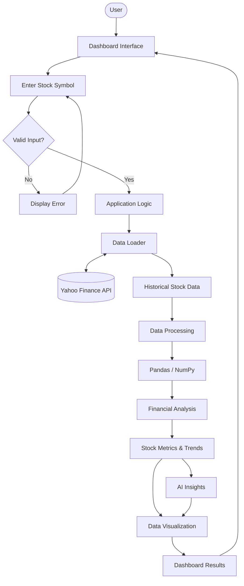

# 📈 AI Stock Dashboard

An AI-powered stock market analysis project built with Python. The goal is to explore financial data, analyze stock market trends, and develop an interactive dashboard for stock analysis.

## 🚀 Project Overview

The AI Stock Dashboard aims to provide an accessible way to explore stock market data and perform financial analysis using Python.

This project is currently under development.

## 🛠️ Technologies Used

- **Python** – Core programming language
- **Pandas** – Data manipulation and analysis
- **NumPy** – Numerical computations
- **yfinance** – Retrieving historical stock market data
- **python-dotenv** – Environment variable management

## 📂 Project Structure

```text
ai-stock-dashboard/
│
├── src/
│   └── data_loader.py
│
├── requirements.txt
├── README.md
└── SETUP.md
```

## ⚙️ Installation and Setup

### 1. Clone the repository

```bash
git clone https://github.com/pramitraych-os/ai-stock-dashboard.git
```

### 2. Navigate to the project directory

```bash
cd ai-stock-dashboard
```

### 3. Create a virtual environment

```bash
python3 -m venv .venv
```

### 4. Activate the virtual environment

**macOS / Linux:**

```bash
source .venv/bin/activate
```

**Windows:**

```bash
.venv\Scripts\activate
```

### 5. Install dependencies

```bash
pip install -r requirements.txt
```

## 📊 Planned Features

- Historical stock price analysis
- Stock market data visualization
- Stock performance comparison
- Financial trend analysis
- AI-powered stock insights

*Features will be implemented progressively.*

## 🔮 Future Improvements

- **Portfolio Management:** Track investments, portfolio performance, and profit/loss.
- **Stock Price Alerts:** Implement automated notifications based on predefined stock price levels.
- **Risk Analysis:** Introduce financial risk metrics such as volatility, Sharpe ratio, and maximum drawdown.
- **Stock Screener:** Filter stocks based on financial indicators and fundamental metrics.
- **Backtesting:** Evaluate trading strategies using historical market data.
- **Benchmark Comparison:** Compare individual stock performance with major market indices.

## 👨‍💻 Author

**Pramit Raychaudhuri**

GitHub: [@pramitraych-os](https://github.com/pramitraych-os)

## 📌 Project Status

The project has been successfully completed. All planned core features have been implemented and the dashboard is ready to use.

Future enhancements may be added to improve functionality and user experience.

---

## 🏗️ System Architecture

The following flowchart illustrates the overall architecture and workflow of the AI Stock Dashboard, including data acquisition, processing, analysis, and visualization.


---

If you find this project interesting, feel free to star ⭐ the repository!
